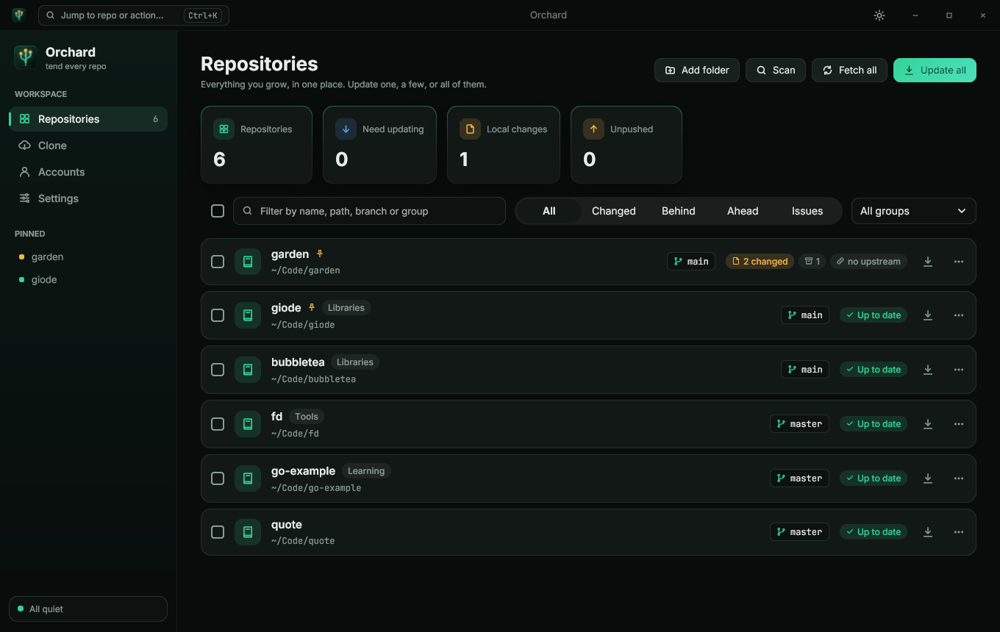
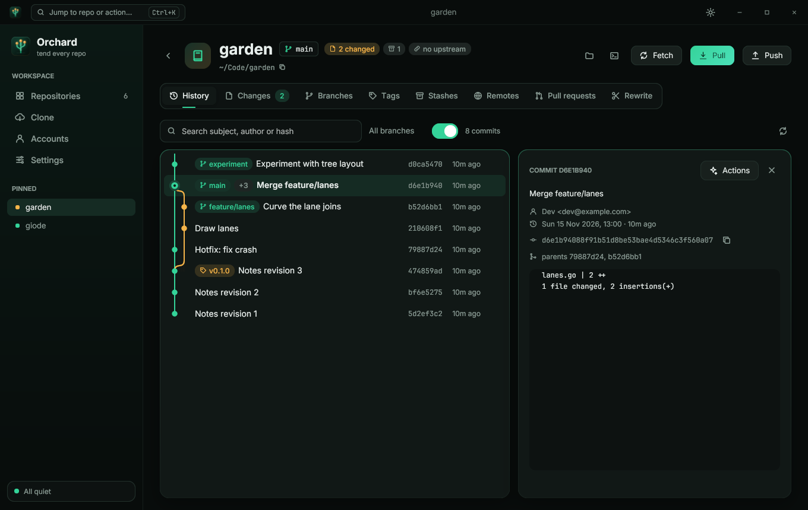
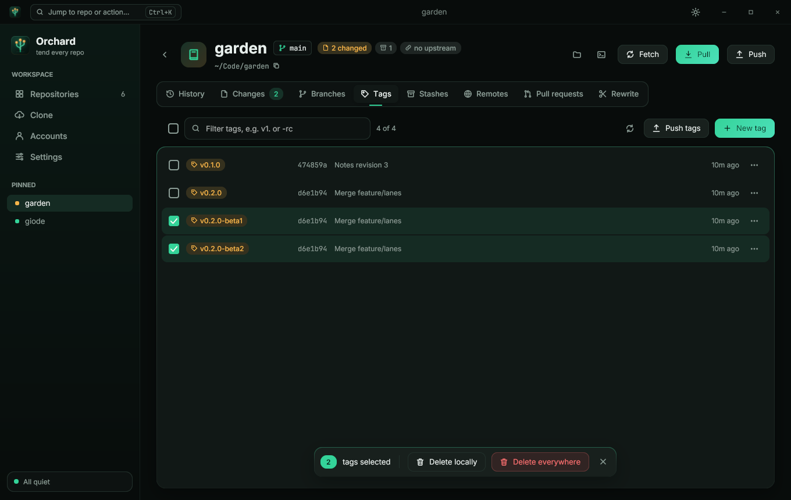
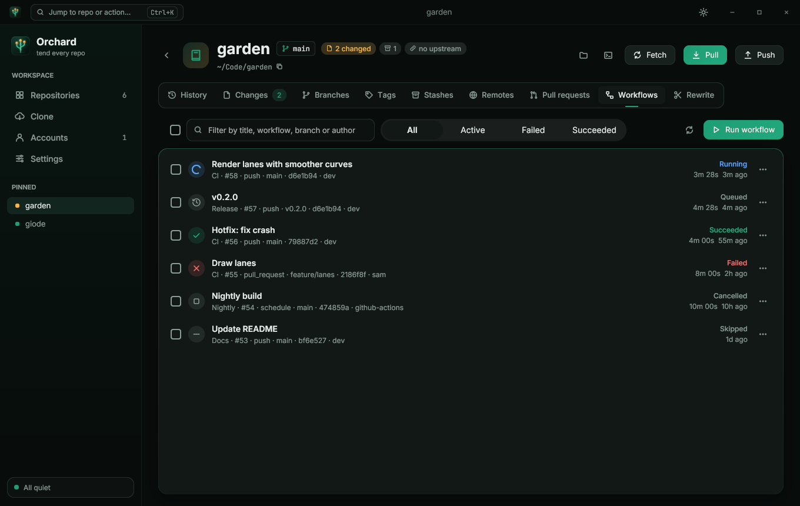
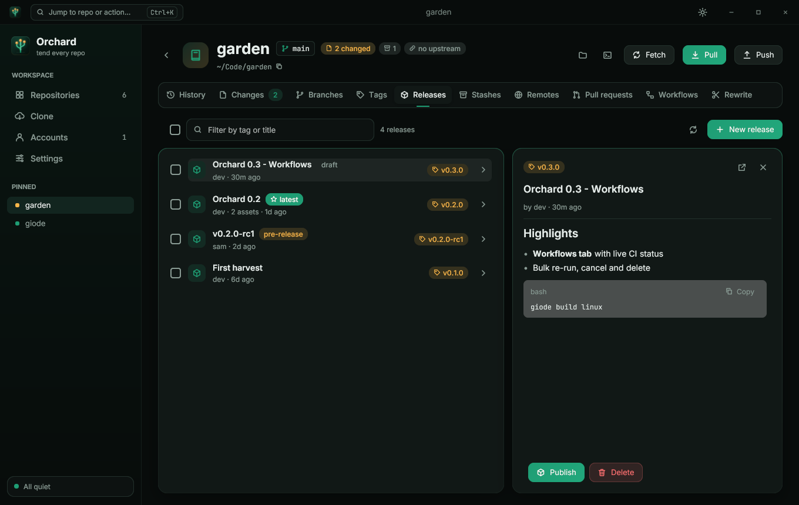

# Orchard

**Tend every repo.** Orchard is a desktop app that keeps every git repository on your computer in
one place: add the ones you already have (or scan a folder for all of them), clone new ones, and
update one, a few or all of them with a click instead of visiting each folder.

Built in Go with [Giode](https://github.com/xmhrnx/giode) (GPU-rendered, no webview) and packaged
with the Giode CLI for Windows, macOS and Linux.

Website: [xmhrnx.github.io/orchard](https://xmhrnx.github.io/orchard/)



## What it does

**Your whole orchard at a glance**
- Every tracked repository with its branch, incoming and outgoing commits, local changes, stashes
  and problems (no upstream, errors), plus headline counts.
- Sections by host (github.com, gitlab.com, your own server, local remotes, no remote) by
  default, or by your own groups, or none. Fold a section away or update everything in it.
- Filter by state (changed, behind, ahead, issues), search by name, path, branch or group, and
  organise repositories into groups and pins.
- **Update all**, **Fetch all**, or check a few and update, fetch, push, group or untrack them
  together. Updates run in parallel with a configurable limit, stash local changes around the
  pull if you want, and report a summary.
- Background fetch keeps the counts fresh.
- Add a folder, drop folders on the window, or scan a directory tree and pick which of the found
  repositories to add.

**Any host that speaks git**
- Clone by URL from GitHub, GitLab, Gitea/Forgejo/Codeberg, Bitbucket, Azure DevOps or any
  self-hosted server, with live progress.
- Connect accounts (GitHub, GitLab, Gitea/Forgejo, Bitbucket; public or self-hosted) to browse
  your repositories and **clone many at once**. Tokens are kept in the system credential store
  (Keychain, Credential Manager, Secret Service), never in the settings file.

**Inside a repository**
- **History**: a commit tree with curved, coloured lanes across all branches; search; a detail
  panel with the message, patch and actions (branch or tag here, check out, cherry-pick, revert,
  reset).
- **Changes**: staged and unstaged files with diffs, stage/unstage/discard (double-click to
  stage), commit, amend, commit & push.
- **Branches**: local and remote, switch, merge, rebase, rename, prune merged branches, and
  **delete several at once** (on the server too for remote branches).
- **Tags**: create, push, and **delete any number of tags at once**, locally or everywhere, in a
  single push.
- **Releases**: GitHub, GitLab and Gitea/Forgejo releases with their notes rendered and their
  downloads; create releases (from an existing or new tag, as drafts or pre-releases, with
  generated notes on GitHub), publish drafts, and **delete many releases at once**, optionally
  removing their tags from origin and this computer too.
- **Stashes** and **Remotes**: everything you'd expect.
- **Pull requests**: list open pull/merge requests and **close or merge many at once**.
- **Workflows**: CI runs from GitHub Actions, GitLab pipelines and Bitbucket Pipelines with live
  status (the list refreshes itself while runs are going), filters for active, failed and
  succeeded runs, **re-run, cancel or delete many runs at once**, and start a workflow by hand on
  any branch or tag.
- **Rewrite**: what git doesn't make easy. Remove files or folders from all of history, scrub
  leaked secrets, fix an author identity, strip large files, find the largest files ever
  committed, squash recent commits, reword or undo the last commit, and force-push the result.
  Uses `git-filter-repo` when installed and falls back to `filter-branch`.

**Quality of life**
- Command palette (`Ctrl/⌘+K`) to jump to any repository or run any action.
- Shortcuts: `Ctrl/⌘+Shift+U` update all, `Ctrl/⌘+Shift+F` fetch all, `F5` refresh,
  `Ctrl/⌘+1/2/3/,` for the pages, `Alt+←` back.
- Open a repository in the file manager or a terminal, copy paths and hashes.
- Dark ("night orchard") and light ("morning orchard") themes, custom frameless window with
  macOS-style traffic lights on a Mac and Windows-style controls elsewhere, animated transitions.









## Requirements

- [git](https://git-scm.com) on the `PATH`.
- Optional: [git-filter-repo](https://github.com/newren/git-filter-repo) for the fastest history
  rewrites and for scrubbing secrets and stripping large files.

## Building

```bash
go install github.com/xmhrnx/giode-cli/cmd/giode@latest
```

```bash
giode run
```

```bash
giode build linux windows
```

Packages land in `dist/<platform>`. macOS builds need a Mac with Xcode (`giode build macos dmg`).
`giode doctor` lists what this computer is missing. Plain `go run .` works on the desktop too.

On Linux, Gio needs the usual development headers:

```bash
sudo apt install gcc pkg-config libwayland-dev libx11-dev libx11-xcb-dev libxkbcommon-x11-dev libgles2-mesa-dev libegl1-mesa-dev libffi-dev libxcursor-dev libvulkan-dev
```

```bash
go test ./...
```

## Layout

```
main.go              wiring only: window config, workspace, root view
giode.toml           app metadata for the Giode CLI
site/                the one-page website (published by .github/workflows/site.yml)
assets/              app icon (brand/icon.svg is the source), UI glyphs, fonts
internal/
  gitx/              the git engine: runs the git CLI (status, log, sync, branches, tags,
                     stashes, remotes, diffs, clone with progress, history rewriting)
  graph/             lays out commit history as lanes for the tree
  forge/             GitHub, GitLab, Gitea/Forgejo and Bitbucket APIs (pull requests, CI runs, releases)
  store/             settings, repositories and accounts on disk
  batch/             bounded parallel work over many items
  core/              the workspace: tracked repositories, bulk operations, accounts
ui/
  app.go             the root view; shortcuts.go and commands.go beside it
  theme/             palettes, fonts and shared style tokens
  env/               what screens share: window, workspace, toasts, navigation
  shell/             window bar, sidebar, command palette
  screens/           one page, tab, card or dialog per file
  components/        the UI kit, one component per file
```

The `internal` packages have no UI dependency and are tested on their own; the UI reads state and
runs work in goroutines that post results back to the UI thread.

## Fonts

Inter and JetBrains Mono are bundled under the SIL Open Font License; their licenses are in
`assets/fonts`.
